# Hub design review (2026-11-19)

This document is a design and UX review of the hub page. It proposes five changes.
It contains no product code. The mockups are static HTML files and screenshots.

The review does not reopen the fixed decisions: the blue accent, the slate neutrals, sans
headings, no web fonts, each project keeps its own brand, and the two featured projects.
For Lighthouse scores, see `night-run/H2-audit.md`. For the identity rules, see
`night-run/H4-identity-v1.1.md`. This review does not repeat that work.

## Summary

| Rank | Change | Size | Risk |
| --- | --- | --- | --- |
| 1 | The whole card opens the project site | S | Low |
| 2 | A compact header on a phone | S | Low |
| 3 | The release is a link with a date, and the feed link is near the top | M | Low |
| 4 | One line of facts on each card | S | Low |
| 5 | The page says what it is, with the YS mark | S | Low |

All five changes together, at 390 px:

| Before | After |
| --- | --- |
| 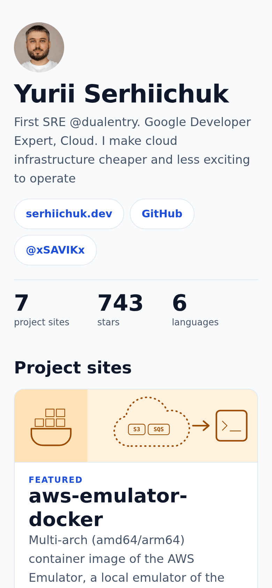 | 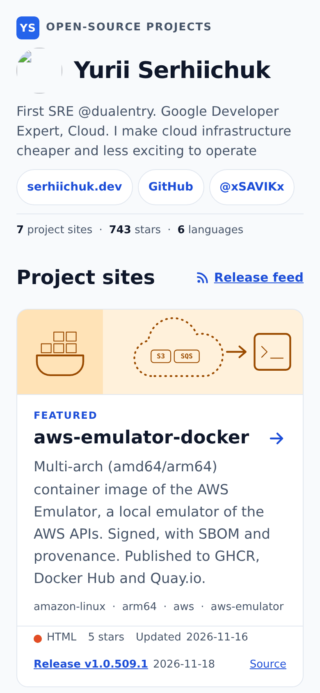 |

All five changes together, at 1280 px:

| Before | After |
| --- | --- |
| 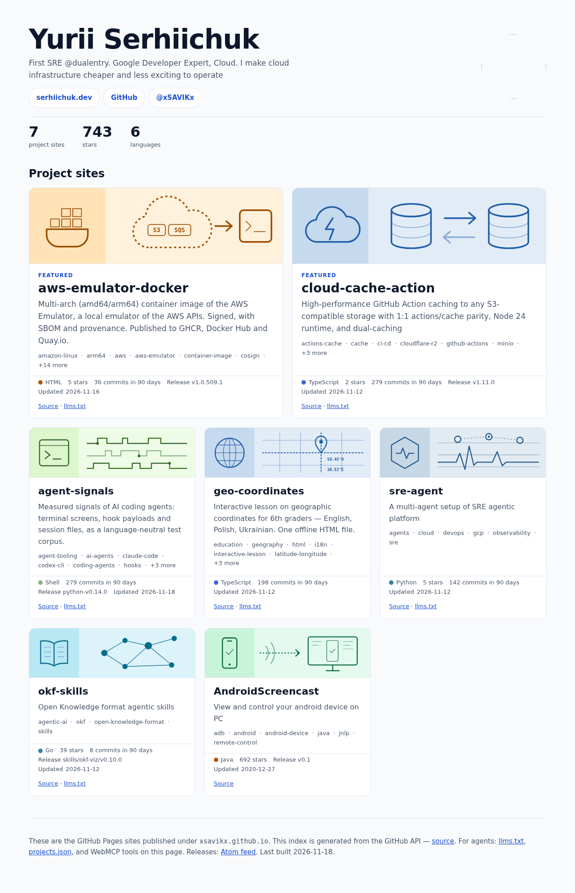 | 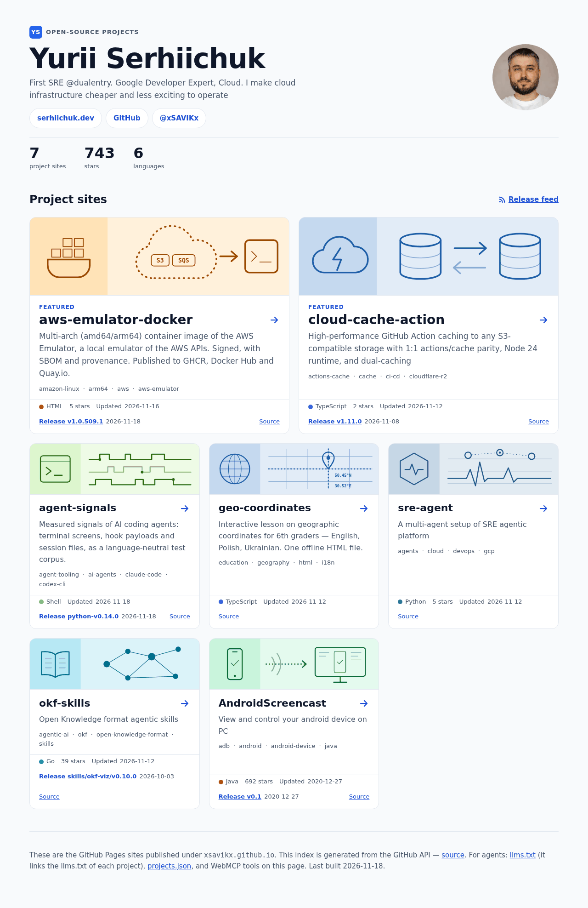 |

More cards of the combined mockup on a phone: `shots/after-all-phone-cards.png`.

## Method

1. I used the build in `dist/` of this branch (built 2026-11-18 19:46 UTC, real GitHub data).
   I did not build again.
2. I served `dist/` on localhost and opened it in Chromium on p1 with the DevTools tool.
3. I measured positions and sizes with a script in the page, at 390 x 844 and at 1280 x 800.
4. I made each mockup from the built page with a script. The script is not in the repository.
5. I took each screenshot from the served page or the served mockup.

The browser on p1 has no internet. For the screenshots, I replaced the avatar address with a
local copy of the same image. The mockup files keep the real avatar address.

## Change 1: the whole card opens the project site

**The problem.** A card has one link to its project site: the project name. The name has the
text colour and no underline. The card art is the largest object on the card, and it is not
a link. The blue, underlined links on the card are "Source" and "llms.txt". Thus the
strongest link cue on a card leads to GitHub or to a text file for agents.

**What I measured.**

- At 1280 px, the name link of the first card is 334 x 44 px. The card is 566 x 513 px.
  The link covers 5% of the card.
- At 390 px, the name link covers 4% to 11% of each card.
- Each card has three tab stops: the name, "Source" and "llms.txt". Six of seven cards have
  the "llms.txt" link. The page has 28 links.

**Why it matters.** The purpose of the hub is to send a visitor to a project site. A phone
visitor taps the picture first, and nothing occurs. The path from the hub to a project must
be the easiest action on the page.

**The proposed change.**

- Keep one link for each card: the project name. Its `::after` element covers the card.
  The accessible name stays the project name, so the screen reader output does not change.
- Show a blue arrow at the end of the title row. The arrow is decoration (`aria-hidden`).
- On hover, the card edge becomes blue and the name gets an underline.
- On keyboard focus, the focus ring goes around the whole card.
- "Source" stays a separate link above the card link.
- Remove "llms.txt" from the card. The hub `/llms.txt` and `projects.json` already link the
  llms.txt of each project, and the footer names them.
- On one column (below 640 px), a featured title has the same size as the other titles.
  At 390 px, the featured title "aws-emulator-docker" wraps to two lines today.

| Before (390 px) | After (390 px) |
| --- | --- |
| 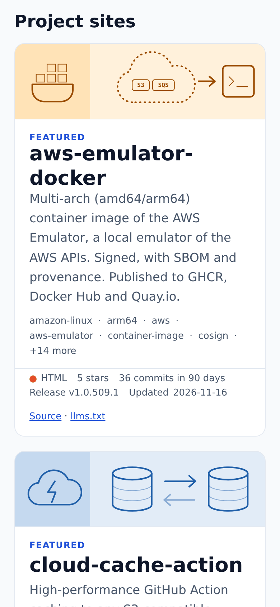 | 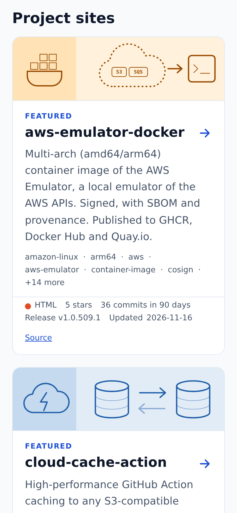 |

Keyboard focus at 1280 px: 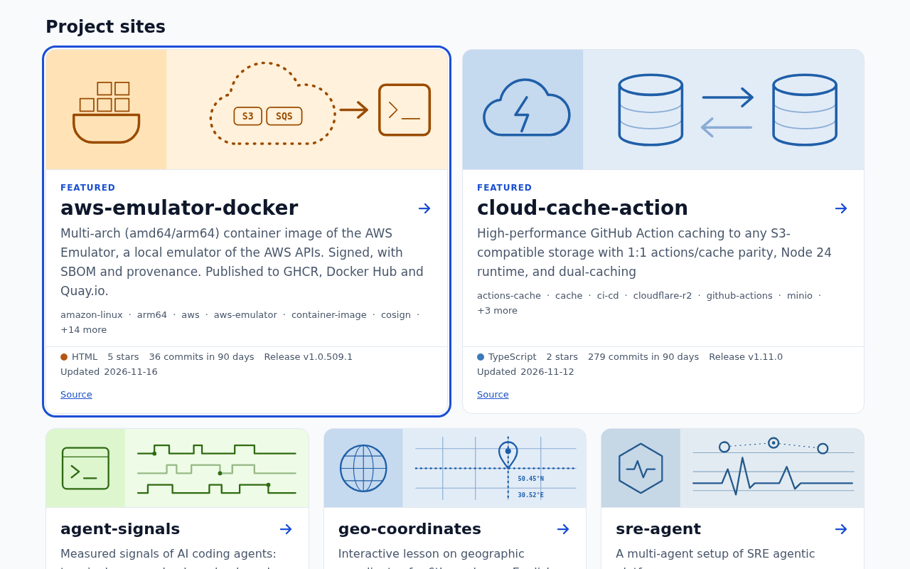

Mockup: `mockups/after-1-card-link.html`. In the mockup, the link covers the whole card
without the "Source" link, and the page has 22 links.

**Size.** S. Files: `scripts/lib/render-html.mjs` (`renderCards`), `src/styles.css`,
`test/render-html.test.mjs`, `docs/ARCHITECTURE.md`.

**Risk.** Low.

- A visitor cannot select card text with one drag, because the link covers the text.
- The focus rule uses `:has()`. An old browser without `:has()` shows no ring on the card.
  Add a fallback: keep the ring on the name link where `:has()` is not available.
- The print block must hide the arrow.
- The words "Open site" are clearer than an arrow. But visible words that are not in the
  link name are a problem for voice control (WCAG 2.5.3). So the mockup uses an arrow.

## Change 2: a compact header on a phone

**The problem.** At 390 px, the header fills most of the first screen. The avatar has its
own row. The three profile links wrap to two rows. The three figures have their own block.

**What I measured (390 x 844).**

- The heading "Project sites" starts at 514 px. The header uses 61% of the first screen.
- The first project name starts at 695 px. Its description is below the first screen.
- The first card ends at 1105 px.
- The page is 4011 px high, which is 4.75 screens for seven projects.

**Why it matters.** A phone visitor sees a person profile first and no complete project. Many
visitors arrive from a project site and look for the other projects.

**The proposed change (below 768 px only).**

- Put the avatar (56 px) beside the name. The name is 28 px.
- Keep the profile links in one row. Each link stays 44 px high.
- Write the figures as one line of text.
- The desktop layout does not change.

| Before | After |
| --- | --- |
|  | 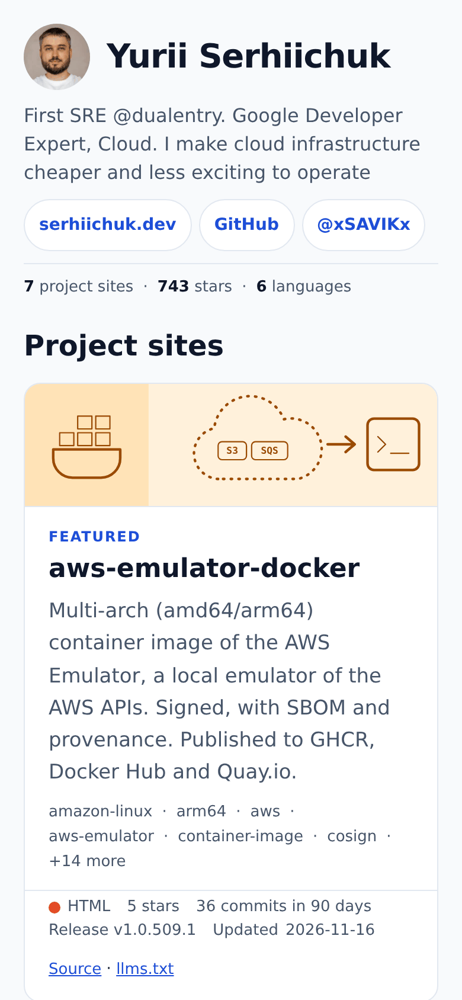 |

Mockup: `mockups/after-2-phone-header.html`. In the mockup, the heading starts at 278 px,
the first project name at 459 px, and the description at 503 px. The page is 3752 px high.

**Size.** S. Files: `src/styles.css` only.

**Risk.** Low.

- The three links fit in one row at 390 px with 10 px to spare on p1 fonts. A longer X handle
  can wrap the row at 320 px. The row must be free to wrap there.
- The rule uses `display: contents` on the `.intro` block. Test the reading order with a
  screen reader one time.

## Change 3: the release is a link with a date, and the feed link is near the top

**The problem.** The card shows "Release v1.0.509.1" as plain text with no date and no link.
The only visible link to the Atom feed is the last link of the footer. A visitor who opens
the feed in a browser sees raw XML.

**What I measured.**

- The feed link is at 3872 px of 4011 px on a phone, and at 1870 px of 1985 px at 1280 px.
- aws-emulator-docker shows "Updated 2026-11-16". Its release date is 2026-11-18. The card
  does not show the newer date.
- AndroidScreencast shows "Release v0.1". That release is from 2020-12-27. The other tags
  are from the last two months. The card does not show the difference.
- In Chromium, `/releases.xml` shows the XML tree and a notice about style information.
- In the feed, each `
` is raw Markdown (`###`, backticks) in one block of text.

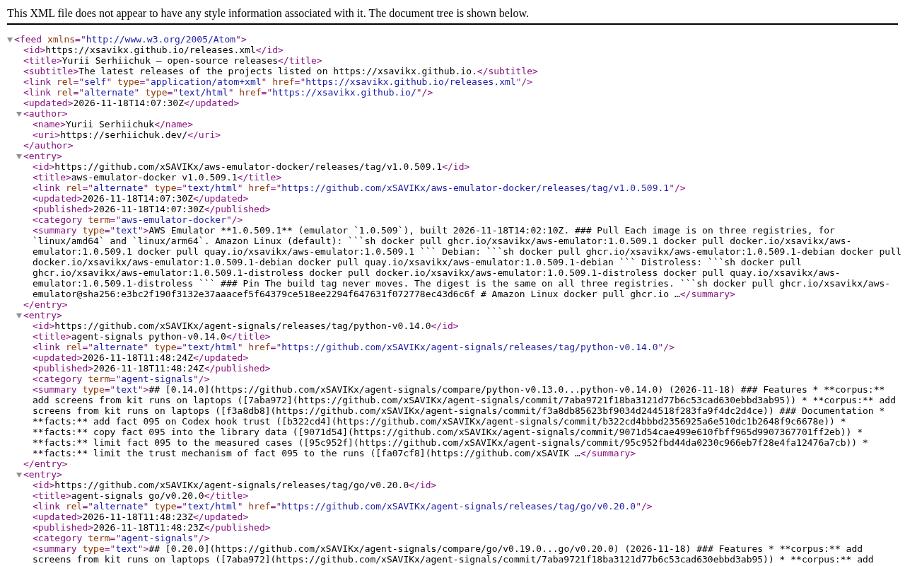

**Why it matters.** A release date is the clearest sign that a tool is alive. The feed is new
work, and a visitor cannot find it. A person who does not know Atom gets no explanation.

**The proposed change.**

1. On the card, make the release a link to the release page on GitHub, and show its date.
   The link text is "Release v1.11.0". The link name is "Release v1.11.0 of
   cloud-cache-action", so no two links share a name. This removes the reason in
   `night-run/H7-releases.md` for plain text.
2. Put the release link in the link row, not in the facts list. Each link in that row is
   44 px high.
3. Put a "Release feed" link with a feed icon in the row of the "Project sites" heading.
   Remove the feed sentence from the footer.
4. Change the feed `<subtitle>` to say what the file is, for example: "An Atom feed. Copy
   this address into a feed reader." That text is near the top of the XML view.
5. In each feed summary, use the first paragraph of the note without Markdown marks.

I do not propose an XSLT style sheet for the feed. From memory, Chrome has a plan to remove
XSLT. I did not check this.

| Before (390 px) | After (390 px) |
| --- | --- |
|  | 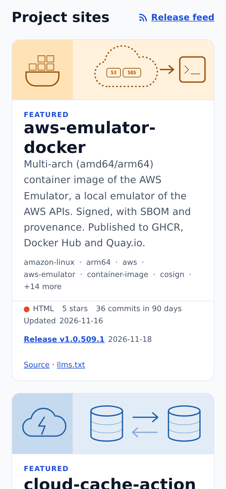 |

Mockup: `mockups/after-3-releases.html`. Items 4 and 5 change the feed file, and they have
no mockup.

Alone, this change adds one row to each card that has a release. With change 1, "llms.txt"
leaves the row, and the release and "Source" share one row. See the combined mockup.

**Size.** M. Files: `scripts/lib/render-html.mjs`, `scripts/lib/render-seo.mjs`,
`src/index.html`, `src/styles.css`, `test/render-html.test.mjs`, `test/render-seo.test.mjs`,
`docs/ARCHITECTURE.md`.

**Risk.** Low.

- A long tag makes the row wrap. In the combined mockup, "Release skills/okf-viz/v0.10.0"
  uses two rows at 390 px and at 1280 px. The other cards use one row.
- A changed `<subtitle>` or summary changes the feed file one time. A feed reader can show
  old entries as changed.
- A summary without Markdown marks needs a small text function. Keep it free of dependencies.

## Change 4: one line of facts on each card

**The problem.** The facts list has up to five items of the same weight: language, stars,
commits in 90 days, release, and the update date. The topics list has up to seven items.
The last topic item, "+14 more", is not a link and gives no action.

**What I measured.**

- At 390 px, the facts list uses two lines on five cards and three lines on two cards.
- At 320 px, the facts list of the first card uses four lines.
- "36 commits in 90 days" and "Updated 2026-11-16" both tell how fresh the project is.

**Why it matters.** A visitor reads a card in a few seconds. Small grey text in several
ragged lines hides the two useful facts: the language and the date.

**The proposed change.**

- Facts: language, stars (when above zero), and the update date. The release moves to the
  link row (change 3).
- Remove the commit count from the card. It stays the sort key of the grid.
- Show four topics at most. Remove the "+N more" item.

| Before (390 px) | After (390 px) |
| --- | --- |
|  | 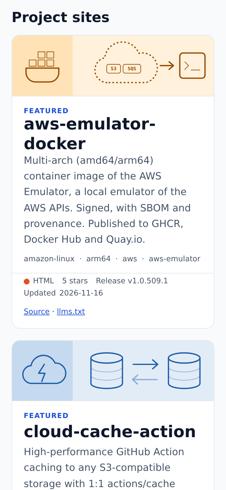 |

Mockup: `mockups/after-4-card-facts.html`. In this mockup the release is still in the facts
list, because change 3 moves it. The page is 3761 px high at 390 px (4011 px before).

**Size.** S. Files: `scripts/lib/render-html.mjs` (`TOPIC_CAP`, the facts list),
`test/render-html.test.mjs`, `docs/ARCHITECTURE.md` (it says that the card shows the activity).

**Risk.** Low. The commit count is a decision of an earlier design. The order of the grid
then has no visible reason on the card. All topics stay in `projects.json` and in JSON-LD.

## Change 5: the page says what it is, with the YS mark

**The problem.** The first heading is the name of a person. The words "open-source projects"
are in the browser title only. The identity gives the person sites the blue accent and the
"YS" mark (`identity/README.md`, principle 2). The hub shows the mark only as the favicon.

**What I measured.** I read the built HTML. No visible text before the "Project sites"
heading says that the page is a list of projects. The page has no visible "YS" mark.

**Why it matters.** The footer line of a project site says "Part of Yurii Serhiichuk's
open-source projects". A visitor who follows it arrives at a page with a different title.
The mark also ties the hub to serhiichuk.dev and the CV.

**The proposed change.** Add one small line above the name: the "YS" mark (28 px, the same
drawing as `src/favicon.svg`) and the words "Open-source projects" in muted capitals.
The `<h1>` does not change.

| Before (1280 px) | After (1280 px) |
| --- | --- |
| 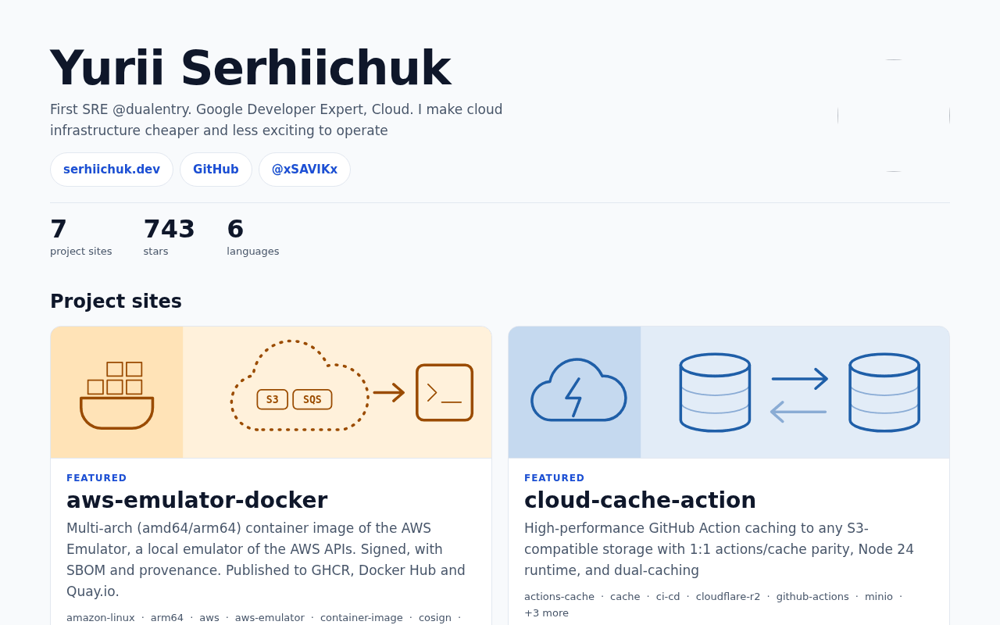 | 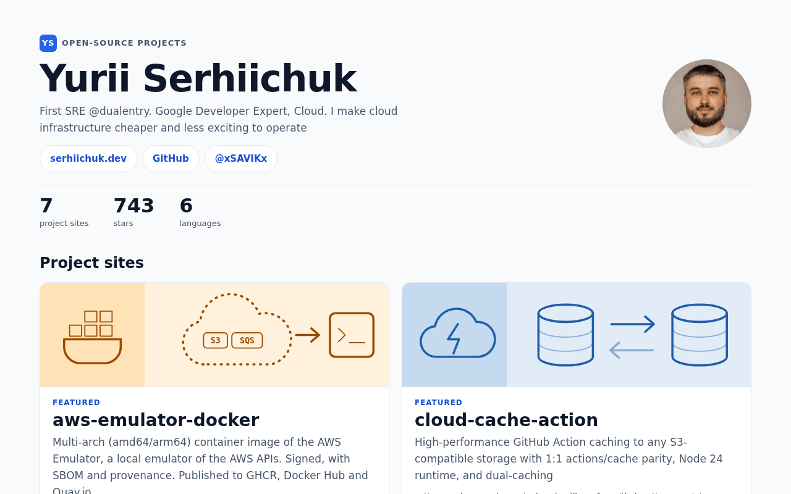 |

Mockup: `mockups/after-5-page-name.html`. The phone view is in the combined mockup.

**Size.** S. Files: `src/index.html`, `src/styles.css`.

**Risk.** Low. The line adds 40 px above the name at 1280 px. On a phone it adds one row of
approximately 40 px, and change 2 saves more than that. I did not see serhiichuk.dev in the browser, so I
did not compare the mark with its header.

## All changes together: measured results

| Measure | Before | After (all five) |
| --- | --- | --- |
| Page height at 390 px | 4011 px | 3495 px |
| "Project sites" heading at 390 px | 514 px | 324 px |
| End of the first card at 390 px | 1105 px | 837 px (inside the first screen) |
| Links on the page | 28 | 27 |
| Share of a card that opens the project | 4% to 11% | the whole card, without the link row |
| Smallest link target at 390 px | 45 x 44 px | 45 x 44 px |
| Horizontal scroll at 390 px | none | none |
| Page height at 1280 px | 1985 px | 1975 px |

Mockup: `mockups/after-all.html`.

## Smaller findings (not ranked, no mockup)

- aws-emulator-docker shows the language "HTML". GitHub detects it from the repository
  files. The project is a container image. See question 11.
- The header figure "743 stars" includes 692 stars of AndroidScreencast, the last card,
  which has its last update in 2020.
- In dark mode, the card edge has 1.31:1 contrast against the page. The edge is decoration,
  so WCAG permits it. After change 1 the arrow and the name identify the card as a link.
- The hub style sheet does not use the underline offset of identity 1.1. This belongs to H4.

## Accessibility checks of the current page

These checks add to the Lighthouse result of H2 (accessibility 100).

- 320 px wide: no horizontal scroll, no element past the right edge.
- Dark mode at 320 px: muted text on a card 7.40:1, link text on a card 6.92:1, muted text
  on the page 8.03:1. H2 did not check dark mode on a phone.
- Forced colours at 390 px: all text and links are visible, and the card edges show.
- Headings: one `h1`, one `h2`, seven `h3`. Landmarks: header, navigation, main, footer.
- Tab order follows the visual order. Each link target is 44 px high or more.

## What I measured and what I did not measure

Measured:

- Positions, sizes, link counts and page heights, in Chromium on p1, at 390 x 844, 320 x 640
  and 1280 x 800.
- Contrast of three text pairs in dark mode, from the computed colours.
- The same numbers on each mockup.

Not measured:

- A real phone. p1 has Linux fonts, which are wider than the system fonts of iOS and Android.
  Line breaks and heights are different on a real phone.
- Safari and Firefox.
- A screen reader and voice control.
- The mockups in dark mode and in forced colours.
- What visitors do. I have no visit data, so I do not know which links they use.
- The feed in a feed reader.
- The live origin. The numbers are from localhost.
- serhiichuk.dev and the project sites. I did not compare their look with the hub.
- Performance after the changes. The changes add no image, no script and no font.

## Notes on the mockup files

- `mockups/before.html` is the built page with its style sheet inline. The after files add
  one marked block of CSS and change the card markup.
- The mockups write the dot of the hub host as `&#46;`. `test/origin.test.mjs` permits the
  literal host name in one source file only.
- Links to `/llms.txt`, `/projects.json` and `/releases.xml` do not work from a local file.
- `npm test` passes with this folder in the repository (131 tests).

## Operator questions

1. Change 1: do you approve that the whole card opens the project site? (yes / no)
2. Change 1: remove the "llms.txt" link from each card? Agents keep `/llms.txt` and
   `projects.json`. (yes / no)
3. Change 1: the cue on the card: an arrow, or the words "Open site"? (arrow / words)
4. Change 2: do you approve the compact phone header? (yes / no)
5. Change 3: the release link leads to the GitHub release page. Is that correct?
   (yes / project site)
6. Change 3: the label of the feed link: "Release feed" or "Atom feed"?
7. Change 3: do you also want a "Latest releases" list below the grid, one row for each
   project? I did not make a mockup of it. (yes / no)
8. Change 4: remove the commit count from the card? It stays the sort key. (yes / no)
9. Change 4: how many topics on a card: 4, or 6 with "+N more"? (4 / 6)
10. Change 5: add the "YS" mark and the line "Open-source projects" above the name?
    (yes / no / other words)
11. Do you want a way to set the language label of a project by hand, for the "HTML" label
    of aws-emulator-docker? (yes / no)
12. Which changes do I implement first? (all / a list of numbers)
